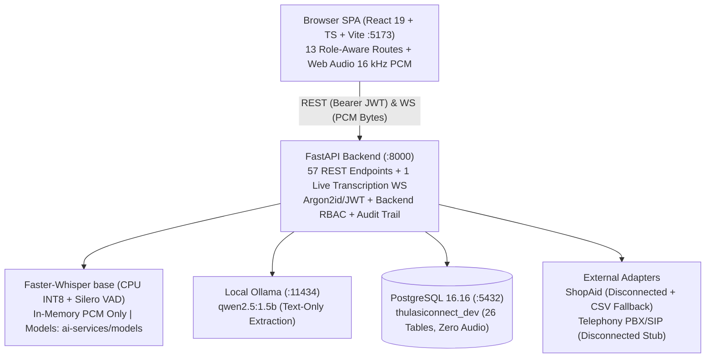
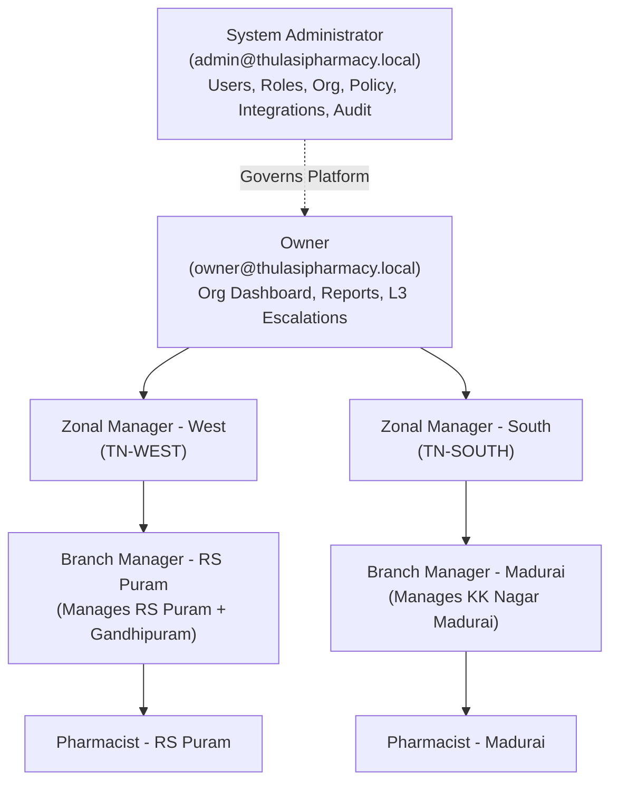
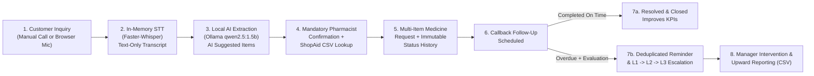

# ThulasiConnect — Complete System Blueprint

> **Document Type:** Master System Discovery, Role Journey & Functional Architecture Blueprint  
> **Audit Date:** 2026-11-18  
> **Project Root:** `C:\Users\KRISHNA KANTH M\Downloads\ThulasiConnect`  
> **Verification Basis:** Full inspection of frontend (`frontend/src/`), backend (`backend/app/`), migrations (`backend/alembic/`), scripts (`scripts/`), tests (`tests/`, `frontend/e2e/`), and live read-only PostgreSQL 16 (`thulasiconnect_dev`) audit. Zero source code or database modifications were performed during discovery.

---

## 1. Executive Summary

**ThulasiConnect** is a modular-monolith enterprise web application designed to eliminate dropped, unregistered, and forgotten customer telephone inquiries across multi-branch **Thulasi Pharmacy** locations.

### Key Architectural Highlights (Verified in Code)
- **Full-Stack Core:** React 19 + TypeScript + Vite + Tailwind CSS v4 frontend connected via Bearer JWT REST (`57` endpoints) and authenticated WebSocket (`1` endpoint) to a FastAPI + SQLAlchemy 2.1 + Alembic backend backed by PostgreSQL 16 (`26` application tables).
- **Transcription-Only Privacy Architecture:** Live browser microphone audio is captured as 16 kHz Int16 PCM strictly in RAM, streamed to local **Faster-Whisper `base` (CPU INT8 + Silero VAD)**, converted to editable text segments, and immediately discarded. Zero audio columns, zero audio playback widgets, and zero external cloud AI calls exist in the application. *(Note: Pre-existing developer script `tests/record_sample.py` + `tests/sample.wav` exist inside `tests/` only and must remain outside production.)*
- **Human-in-the-Loop Local AI:** Local **Ollama (`qwen2.5:1.5b`)** extracts structured medicine suggestions from **transcript text only** (with deterministic fallback), explicitly tagged `ai_suggested` / `missing_info` with a non-medical-advice disclaimer requiring explicit pharmacist confirmation before database persistence.
- **5-Role Hierarchical Supervision:** Strict backend-enforced RBAC across `pharmacist`, `branch_manager`, `zonal_manager`, `owner`, and separately controlled `system_admin`.
- **Honest External Adapter Boundaries:** **ShopAid Inventory** is read-only and **Disconnected** (with a working CSV catalog reference fallback); **Pharmacy Telephony (PBX/SIP)** is **Disconnected** (clearly separating `browser_microphone_test` from `manual_telephone_call` and `verified_telephony_integration`).

---

## 2. System Architecture Overview

---

## 3. Organizational Hierarchy & Bootstrapped Roles

The platform separates **Business Supervision** (`Owner → Zonal Manager → Branch Manager → Pharmacist`) from **Technical System Administration** (`System Administrator`):

| Role | Scope | Primary Daily Focus | Key Restrictions |
|---|---|---|---|
| **Pharmacist** | `self` | Live Call Desk, manual call logging, confirming AI medicine items, multi-item requests, completing customer callbacks | Own records only; no Reports, Branches, Zones, Escalations, or Admin |
| **Branch Manager** | `branch` | Branch KPIs & staff workload, assigning requests/follow-ups, resolving Level 1 escalations, branch settings & CSV reports | Assigned branch(es) only; no other branches, Zones, or User Admin |
| **Zonal Manager** | `zone` | Cross-branch comparisons inside authorized zone, Level 2 escalations, zonal drilldown & CSV reports | Authorized zone only; read-only on calls/requests; no Admin |
| **Owner** | `org` | Organization-wide Zone & Branch dashboards, critical Level 3 escalations, org CSV reports | Read-only operations; no User/Role/Audit Admin unless separately granted `system_admin` |
| **System Administrator** | `org` | User accounts, RBAC inspection, Zone/Branch creation, ShopAid CSV imports, Escalation Policy, Audit Logs | No Live Call Desk or business escalation resolution |

---

## 4. Core End-to-End Operational Lifecycle

---

## 5. Dashboards, Reporting & Data Roll-Up

- **Bottom-Up Aggregation:** Every `Call`, `MedicineRequest`, `FollowUp`, and `Escalation` is tagged with `branch_id` (and `employee_id` where operational). Metrics roll up cleanly without cross-branch double counting: `Pharmacist (self)` → `Branch Manager (branch)` → `Zonal Manager (zone)` → `Owner (org)`.
- **Transparent Metrics:** `/api/performance/employees` exposes exact `METRIC_DEFINITIONS` alongside 9 real metrics (`calls_registered`, `microphone_test_sessions`, `requests_created`, `requests_resolved`, `pending_workload`, `overdue_followups`, `avg_resolution_hours`, `registration_completeness_pct`, `followup_completion_rate_pct`).
- **8 Real-Data Reports with CSV Export:** Daily/Weekly/Monthly Calls, Branch Performance, Employee Performance, Pending Requests, Overdue Follow-ups, and Escalations.

---

## 6. High-Priority System Gaps & Confirmed Defects (Summary)

| Category | Key Findings (Full Detail in Doc 14) |
|---|---|
| **Confirmed Defects** | (1) `rbac.py` unconditionally re-merges baseline `ROLE_DEFINITIONS` permissions, preventing DB permission revocation; (2) `calls_today` includes `browser_microphone_test` whereas `registered_calls` excludes it; (3) `requests_created` metric filters by `assigned_employee_id`; (4) Level 3 escalation targets only `owners[0]`; (5) `FollowUpsPage` renders **Complete** button for read-only roles (backend correctly enforces `403`); (6) `evaluate-escalations` is callable by any logged-in user across all branches. |
| **Implemented Backend / Missing UI** | `/api/customers` CRUD & autocomplete; `PATCH /api/users/{id}` full edit modal; `PUT /api/roles/{id}/permissions` editor; `PATCH /api/zones/{id}` & branch manager assignment dropdown; `PATCH /api/integrations/{key}` config form; post-creation medicine item editing; Call date/employee filters & Call Detail linked-request links; Audit Log UI filters. |
| **Missing Automation & External Integrations** | No automated background scheduler for overdue follow-ups/escalations (on-demand trigger only); ShopAid live API disconnected (CSV snapshot fallback active); PBX/SIP telephony disconnected; no SMTP relay for production password resets; real-world Tamil/Tanglish transcription accuracy not yet benchmarked. |

---

## 7. Complete Discovery Document Index (`docs/system-discovery/`)

1. [`01_APPLICATION_OVERVIEW.md`](docs/system-discovery/01_APPLICATION_OVERVIEW.md) — Complete system architecture, stack status, and layer communication
2. [`02_ROLE_AND_PERMISSION_MATRIX.md`](docs/system-discovery/02_ROLE_AND_PERMISSION_MATRIX.md) — All 5 roles, 8 bootstrapped accounts, and 51-permission matrix
3. [`03_PHARMACIST_WORK_JOURNEY.md`](docs/system-discovery/03_PHARMACIST_WORK_JOURNEY.md) — Pharmacist end-to-end journey, example, and gaps
4. [`04_BRANCH_MANAGER_WORK_JOURNEY.md`](docs/system-discovery/04_BRANCH_MANAGER_WORK_JOURNEY.md) — Branch Manager supervision journey, example, and gaps
5. [`05_ZONAL_MANAGER_WORK_JOURNEY.md`](docs/system-discovery/05_ZONAL_MANAGER_WORK_JOURNEY.md) — Zonal Manager regional supervision journey, example, and gaps
6. [`06_OWNER_WORK_JOURNEY.md`](docs/system-discovery/06_OWNER_WORK_JOURNEY.md) — Owner executive oversight journey, example, and gaps
7. [`07_SYSTEM_ADMINISTRATOR_WORK_JOURNEY.md`](docs/system-discovery/07_SYSTEM_ADMINISTRATOR_WORK_JOURNEY.md) — System Admin governance journey, example, and gaps
8. [`08_PAGE_BY_PAGE_FEATURE_CATALOG.md`](docs/system-discovery/08_PAGE_BY_PAGE_FEATURE_CATALOG.md) — Every page, filter, button, validation, API, DB table, and status
9. [`09_END_TO_END_WORKFLOWS.md`](docs/system-discovery/09_END_TO_END_WORKFLOWS.md) — Workflows A–S with Mermaid sequence, state, and escalation diagrams
10. [`10_DASHBOARD_AND_REPORTING_ANALYSIS.md`](docs/system-discovery/10_DASHBOARD_AND_REPORTING_ANALYSIS.md) — Exact formulas, roll-ups, 8 reports, and metric discrepancies
11. [`11_DATABASE_AND_API_MAPPING.md`](docs/system-discovery/11_DATABASE_AND_API_MAPPING.md) — ER diagram, 26-table inventory, and 57 REST + 1 WS endpoint map
12. [`12_AI_AND_INTEGRATION_ANALYSIS.md`](docs/system-discovery/12_AI_AND_INTEGRATION_ANALYSIS.md) — Faster-Whisper, Ollama, ShopAid, Telephony, and Privacy audit
13. [`13_ORGANIZATIONAL_DATA_FLOW.md`](docs/system-discovery/13_ORGANIZATIONAL_DATA_FLOW.md) — Hierarchy, upward reporting map, and direct-API RBAC verification
14. [`14_SYSTEM_GAPS_AND_RECOMMENDATIONS.md`](docs/system-discovery/14_SYSTEM_GAPS_AND_RECOMMENDATIONS.md) — Confirmed defects, disconnected APIs, and prioritized recommendations
15. [`15_OPEN_QUESTIONS_AND_UNVERIFIED_FEATURES.md`](docs/system-discovery/15_OPEN_QUESTIONS_AND_UNVERIFIED_FEATURES.md) — Business-owner questions, vendor prerequisites, and pilot test items
