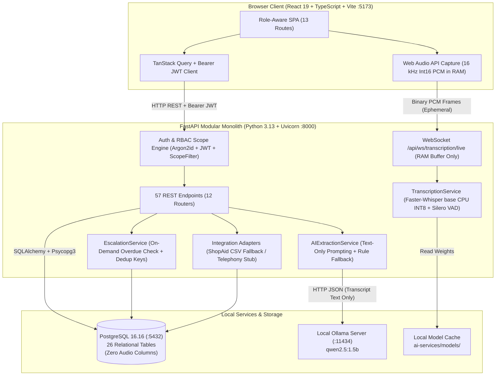

# 01 — Application Overview & System Architecture

> **Audit Scope:** Complete static code inspection of `frontend/`, `backend/`, `ai-services/`, `scripts/`, `tests/`, `.env.example`, and read-only inspection of the live PostgreSQL 16 database (`thulasiconnect_dev`).  
> **Code / DB Modifications Made:** None (read-only discovery).

---

## 1. Executive Purpose

**ThulasiConnect** is an internal, multi-branch pharmacy call management, customer medicine request tracking, and hierarchical management supervision platform built for **Thulasi Pharmacy**.

Its implemented business objective is to close operational accountability gaps in pharmacy telephone inquiries:
1. Capture authorized live speech (browser microphone prototype) or manually registered phone calls so customer inquiries are recorded as structured data rather than forgotten.
2. Convert spoken inquiries (English, Tamil, or Tamil-English mixed speech) into editable text transcripts strictly **in memory** without saving call recordings.
3. Extract structured medicine names, strengths, quantities, availability questions, and pricing questions via a local LLM (`qwen2.5:1.5b` via Ollama) while forcing explicit employee verification before saving.
4. Track every customer medicine request through an audited status lifecycle (`new` through `resolved`/`closed`/`cancelled`).
5. Schedule customer callback follow-ups, detect overdue items, issue deduplicated reminders, and escalate unresolved delays up the management chain (`Branch Manager → Zonal Manager → Owner`).
6. Provide role-scoped dashboards, transparent employee/branch performance metrics, CSV-exportable operational reports, and an immutable administrative audit trail.

---

## 2. Technology Stack (Verified Against Installed Project Files)

| Layer | Technologies Verified in Codebase | Implementation Status |
|---|---|---|
| **Frontend SPA** | React 19, TypeScript 5.9, Vite 6.4, Tailwind CSS v4, React Router v7, TanStack Query v5, Recharts v2, Lucide React, Playwright 1.65 (E2E) | **Fully implemented and working** |
| **Backend API** | Python 3.13 (`.venv`), FastAPI 0.163, Uvicorn 0.54, SQLAlchemy 2.1, Alembic 1.20, Pydantic 2.14, Psycopg 3.3, PyJWT 2.15, Argon2id (`argon2-cffi`), WebSockets 15.0 | **Fully implemented and working** |
| **Database** | Local Portable PostgreSQL 16.16 (`127.0.0.1:5432`, DB `thulasiconnect_dev`, 26 application tables + `alembic_version`) | **Fully implemented and working** |
| **Speech-to-Text** | Faster-Whisper 1.2.1 (`base` multilingual model, CPU INT8, `ctranslate2` 4.9, `onnxruntime` 1.32 Silero VAD, cached at `ai-services/models`) | **Fully implemented and working** (Browser Mic prototype; real-world Tamil/Tanglish accuracy unbenchmarked) |
| **Local LLM** | Ollama 0.40.16 (`127.0.0.1:11434`, `qwen2.5:1.5b`) with deterministic regex/heuristic fallback | **Fully implemented and working** |
| **ShopAid Integration** | Read-only adapter interface (`shopaid_adapter.py`) + CSV catalog snapshot fallback (`shopaid_catalog_items`) | **Partially implemented** (Live API disconnected; CSV fallback working) |
| **Telephony Integration** | Adapter stub (`telephony_adapter.py`) + `verified_telephony_integration` source guard | **UI only / placeholder** (Disconnected; no PBX/SIP bridge yet) |
| **Background Scheduler** | None (`evaluate-escalations` is HTTP-triggered on demand) | **Not implemented** |

---

## 3. System Architecture Diagram

---

## 4. How All Layers Communicate

1. **Authentication Handshake:** The frontend sends credentials to `POST /api/auth/login`. FastAPI verifies the Argon2id hash, resolves the user's roles, permissions, `scope_level` (`self`, `branch`, `zone`, or `org`), `allowed_branch_ids`, and `allowed_zone_ids`, signs an HS256 JWT containing `sub`, `roles`, `jti`, `iat`, and `exp`, and writes an `auth.login_success` audit row. The browser stores the JWT in `localStorage` (`tc_access_token`) and sends it via `Authorization: Bearer <token>` on every subsequent REST request (or `?token=` on WebSocket connect).
2. **Scoped Data Access:** Every protected router runs `get_current_user` → `authenticate_token` (which verifies signature, expiry, `revoked_tokens` table, and `User.is_active`), followed by `require_permissions(...)` and query-level filtering on `employee_id`, `branch_id`, or `zone_id`.
3. **Live In-Memory Transcription:** Inside `LiveCallDeskPage`, clicking **Start Mic** invokes `navigator.mediaDevices.getUserMedia`, captures mono audio, downsamples to 16 kHz Int16 PCM inside browser RAM, and streams binary frames to `/api/ws/transcription/live`. The backend accumulates ~4 seconds (`128,000` bytes) in a volatile `bytearray`, immediately clears the buffer, decodes in a worker thread via `Faster-Whisper`, emits timestamped JSON segments back to the browser, and discards the raw bytes.
4. **Local AI Extraction:** Clicking **Extract Suggestions (Local AI)** posts **only transcript text** to `POST /api/transcription/extract`. `AIExtractionService` calls local Ollama (`127.0.0.1:11434/api/generate`) with `format: "json"`, returning `ai_suggested` / `missing_info` items and a non-medical-advice disclaimer. If Ollama is unreachable or returns malformed JSON, `_heuristic_extract` runs a deterministic regex parser.
5. **Transactional Persistence & Audit Trail:** Call registrations, text-only transcripts, multi-item medicine requests, immutable status histories, follow-ups, escalations, notifications, and administrative actions are committed transactionally into PostgreSQL 16 alongside `audit_logs` records.
6. **External Integration Boundaries:** Both ShopAid (`shopaid_inventory`) and Telephony (`telephony_pbx`) are isolated behind dedicated service adapters (`shopaid_adapter.py`, `telephony_adapter.py`) and tracked in `integration_configs`, keeping core workflows decoupled from external vendor availability.

---

## 5. Module-Level Implementation Status Summary

| Module | Backend Status | Frontend Status | Overall Status |
|---|---|---|---|
| Authentication, Logout & Password Reset | Fully implemented | Fully implemented | **Fully implemented and working** |
| RBAC & Organizational Scoping | Implemented (see permission-revocation defect in Doc 14) | Role-aware sidebar & route guards working | **Partially implemented** (Role permission edit UI not built; baseline permissions re-merged in code) |
| Role-Adaptive Dashboards | Fully implemented | Fully implemented | **Fully implemented and working** |
| Live Call Desk (3-Panel Workspace) | Fully implemented | Fully implemented | **Fully implemented and working** (Browser Mic prototype) |
| Call Management & Call Detail | Fully implemented | Implemented (missing date/employee filters & linked-request links) | **Partially implemented** |
| Customer Directory (`/api/customers`) | Fully implemented | Not connected (implicit create only) | **Implemented but not fully connected** |
| Customer & Medicine Request Tracking | Fully implemented | Implemented (cannot edit items post-creation) | **Partially implemented** |
| Follow-ups, Reminders & Escalations | Implemented (on-demand trigger only) | Fully implemented | **Partially implemented** (No automated background scheduler) |
| Employee & Branch Performance | Fully implemented | Fully implemented | **Fully implemented and working** |
| Branches & Zones Management | Fully implemented | Branches full; Zones create-only (no edit modal) | **Partially implemented** |
| Reports & CSV Export (8 Report Types) | Fully implemented | Fully implemented | **Fully implemented and working** |
| Notifications Inbox | Fully implemented | Fully implemented | **Fully implemented and working** |
| System Administration (Users/Roles/Policy/Audit) | Fully implemented | Users create + toggle active only; Roles/Integrations read-only | **Partially implemented** |
| ShopAid Inventory Adapter | Read-only CSV fallback working; live API disconnected | Upload & lookup working | **Partially implemented** (Live ShopAid API disconnected) |
| Telephony / SIP / PBX Integration | Config stub only (`disconnected`) | Status display only | **UI only / placeholder** |
