# 03 — Pharmacist / Employee Complete Work Journey

> **Accounts Audited:** `pharmacist.rspuram@thulasipharmacy.local` (`PH-RS01`, RS Puram, Coimbatore) and `pharmacist.madurai@thulasipharmacy.local` (`PH-MD01`, KK Nagar, Madurai)  
> **Role Code:** `pharmacist` • **Scope Level:** `self`

---

## 1. End-to-End Daily Work Journey Diagram

```mermaid
flowchart TD
    Login["1. Sign In (/login)\nPOST /api/auth/login"] --> Dash["2. Pharmacist Operational Dashboard (/)\nGET /api/dashboard/overview"]
    Dash --> CheckAlerts["3. Check Unread Reminders & Overdue Follow-ups\n(/notifications & /followups)"]
    CheckAlerts --> Desk["4. Open Live Call Desk (/live-call)\nChoose Mic Prototype or Manual Telephone"]
    Desk --> RegCall["5. Register Call Session\nPOST /api/calls"]
    RegCall --> Capture["6. Capture Live Speech (WS /api/ws/transcription/live)\nOR Type Manual Transcript Notes"]
    Capture --> EditTr["7. Review & Correct Transcript Segments\nPOST /api/calls/{id}/transcript"]
    EditTr --> AIExt["8. Run Local Ollama Extraction\nPOST /api/transcription/extract"]
    AIExt --> Lookup["9. Optional: Search ShopAid CSV Reference\nGET /api/integrations/shopaid/catalog"]
    Lookup --> Confirm["10. Explicitly Click 'Confirm' on Every Medicine Item\n(AI Suggested -> Employee Confirmed)"]
    Confirm --> SaveReq["11. Save & Close Call + Auto-Schedule Callback\nPATCH /api/calls/{id} + POST /api/requests"]
    SaveReq --> Track["12. Update Request Status as Stock/Price Checked\n(/requests -> PATCH /api/requests/{id})"]
    Track --> CompleteFU["13. Complete Customer Callback with Notes\n(/followups -> PATCH /api/followups/{id})"]
    CompleteFU --> Logout["14. Sign Out\nPOST /api/auth/logout (JWT Revoked)"]
```

---

## 2. Step-by-Step Operational Walkthrough (Login to Logout)

### Step 1: Login & Session Initialization
- Pharmacist navigates to `/login`, enters work email and password, and submits `POST /api/auth/login`.
- Backend verifies Argon2id password, logs `auth.login_success` in `audit_logs`, returns JWT and `UserSummary` (`scope_level: "self"`, `employee_id`, single `branch_id`).
- App redirects to `/`. Sidebar renders **only 8 authorized links**: `Overview`, `Live Call Desk`, `Calls`, `Customer Requests`, `Follow-ups`, `Employees`, `Notifications`, `Settings`. (`Branches`, `Zones`, `Reports`, `Administration` are hidden AND backend-blocked with `403`.)

### Step 2: Pharmacist Operational Dashboard (`/`)
- Loads `GET /api/dashboard/overview?days=30` (adjustable to `7`, `30`, or `90` days).
- **Information & Exact Metric Meanings:**
  - **Calls Today:** Count of the pharmacist's own `calls` with `started_at >= today 00:00 UTC` (includes both telephone calls and browser mic tests).
  - **Pending Requests:** Pharmacist's own `medicine_requests` in open statuses (`new`, `in_progress`, `waiting_for_info`, `waiting_for_stock`, `follow_up_required`).
  - **Overdue Follow-ups:** Pharmacist's own `follow_ups` in `pending`/`overdue` where `due_at < now`.
  - **Registration Rate:** Percentage of the pharmacist's telephone calls (`manual_telephone_call` + `verified_telephony_integration`) with `registration_status in ('registered', 'completed')`. Browser mic tests are shown separately in sublabel.
  - **7-Day Call Activity Trend:** Bar chart splitting Telephone Calls vs Mic Test Sessions vs Missed Calls.
  - **Active Reminders & Alerts:** Top 8 unread `notifications` for this user.
  - **My Personal Performance Summary:** Requests resolved/created, average resolution hours, call registration completeness %, and follow-up completion %.

### Step 3: Handling a Customer Inquiry in Live Call Desk (`/live-call`)
1. **Left Panel (Call Registration):** Pharmacist selects `Browser Microphone Prototype` or `Manually Registered Telephone Call` (`Verified Telephony Integration` is disabled/disconnected), selects `Inbound`/`Outbound`, enters **Customer Name** and **Customer Phone**, selects **Call Outcome** (e.g., `Medicine Inquiry Logged`), optionally types a summary, and clicks **Register Call Session** (`POST /api/calls` → creates `calls` row and auto-creates/reuses `customers` row per `(branch_id, phone_number)`).
2. **Center Panel (Live Transcription — In-Memory Only):**
   - Selects language (`auto`, `en`, or `ta`) and unverified speaker tag (`Unknown speaker`, `Speaker 1`, `Speaker 2`).
   - Clicks **Start Mic** → browser requests microphone permission (`getUserMedia`) → red pulsing badge **`MICROPHONE ACTIVE — IN-MEMORY ONLY`** appears → streams 16 kHz Int16 PCM over WebSocket `/api/ws/transcription/live` → local Faster-Whisper (`base` CPU INT8 + Silero VAD) returns timestamped segments every ~4 seconds → raw PCM bytes are immediately discarded in RAM.
   - Clicks **Stop Mic Immediately** when done (stops media tracks, closes `AudioContext`, sends `{"type":"stop"}` over WS).
   - Can also type manual transcript lines via fallback input and edit any misrecognized Tamil/English medicine names inline (marks `is_edited: true`).
   - Clicks **Save Transcript** (`POST /api/calls/{id}/transcript` → writes `call_transcripts`, `speakers`, `transcript_segments`, `audit_logs`).
3. **Right Panel (AI Extraction & Mandatory Pharmacist Confirmation):**
   - Clicks **Extract Suggestions (Local AI)** → sends transcript text only to `POST /api/transcription/extract` → local Ollama (`qwen2.5:1.5b`) returns structured medicine suggestions with amber `AI Suggested — Unconfirmed` or red `Missing Info` badges plus an explicit non-medical-advice disclaimer.
   - Optionally searches **ShopAid Reference Lookup (CSV Snapshot)** (`GET /api/integrations/shopaid/catalog?q=...`) and clicks **+ Use** to prefill medicine name, strength, and reference MRP (clearly marked as CSV snapshot, not live stock).
   - **Mandatory Verification Gate:** Frontend blocks saving until the pharmacist clicks **Confirm** on every AI-suggested medicine item (changing `verification_status` to `employee_confirmed`).
   - Sets Priority (`low`/`normal`/`high`/`urgent`), Follow-up Due date/time, keeps **Create callback reminder automatically** checked, enters employee notes, and clicks **Save & Close Call**.
   - **Database Changes Created Atomically:**
     - `calls` updated (`registration_status='completed'`, `ended_at=now`)
     - `call_transcripts`, `speakers`, `transcript_segments` upserted
     - `medicine_requests` created (`REQ-YYYYMMDD-XXXXXX`, `status='new'`)
     - `medicine_request_items` rows created (1+ medicines)
     - `request_status_history` initial entry created (`None → new`)
     - `follow_ups` row created (`status='pending'`, linked to `call_id`, `request_id`, `customer_id`)
     - `audit_logs` rows written for call update, transcript save, and request creation.

### Step 4: Managing Requests, Calls & Follow-ups During the Shift
- **Calls (`/calls` & `/calls/:id`):** Search/filter own calls, register quick manual or missed calls (`POST /api/calls`), open Call Detail to edit summary, outcome, or text transcript segments. (Zero audio playback exists.)
- **Customer Requests (`/requests`):** Filter own requests by status/priority, click **Manage** to move a request through `in_progress` → `waiting_for_stock` → `resolved` → `closed` (or `cancelled` with mandatory reason). Every status transition appends an immutable row to `request_status_history`.
- **Follow-ups (`/followups`):** View upcoming and overdue callbacks, schedule standalone follow-ups (`POST /api/followups`), and click **Complete** to record callback completion notes (`PATCH /api/followups/{id}` → marks `completed`, sets `completed_at`, and automatically resolves any open escalations tied to that follow-up).
- **Personal Performance (`/employees`):** Reviews own metrics and the transparent formula definitions.
- **Settings (`/settings`) & Logout:** Can change own password (`POST /api/auth/change-password`), inspect local Faster-Whisper/Ollama health, and click **Sign Out** (`POST /api/auth/logout` revokes JWT immediately).

---

## 3. What Happens When Work Is Delayed or Incomplete?

1. If a pharmacist's follow-up passes `due_at` without completion, the UI immediately flags it as **`overdue`** (red badge).
2. When overdue evaluation runs (`POST /api/followups/evaluate-escalations` via the **Check Overdue & Trigger Escalations** button):
   - Follow-up status updates to `overdue`.
   - Pharmacist receives a deduplicated **in-app reminder notification** (`dedup_key = fu:{id}:employee_reminder`).
   - If overdue duration reaches the branch's `escalation_overdue_minutes` (default `60` min), a **Level 1 Escalation** is created for the **Branch Manager** (with a warning notification).
   - At `240` min overdue → **Level 2 Escalation** to **Zonal Manager** (critical notification).
   - At `1440` min overdue → **Level 3 Escalation** to **Owner** (critical notification).
3. As soon as the pharmacist completes the follow-up (`status='completed'`), all open escalations linked to that follow-up are automatically marked `resolved`.

---

## 4. Realistic End-to-End Operational Example (Implemented & Verified)

> **Scenario (RS Puram Branch — `pharmacist.rspuram@thulasipharmacy.local`):**  
> A customer calls asking in Tanglish: *"Telma 40mg 2 strips stock irukka? Price evlo aagum?"*
> 1. Pharmacist signs in, opens `/live-call`, selects `Manually Registered Telephone Call` (or `Browser Microphone Prototype`), enters synthetic customer details, and registers the call (`TC-...`).
> 2. Captures speech or enters the transcript line and clicks **Extract Suggestions (Local AI)**. Local Ollama (`qwen2.5:1.5b`) suggests `Telma | 40mg | 2 strips | price_inquiry=true` tagged `AI Suggested — Unconfirmed`.
> 3. Pharmacist searches `Telma` in the ShopAid CSV Reference Lookup, sees `Telma 40 (Rs.225.00, csv_snapshot_low_stock)`, checks physical stock/ShopAid terminal, sets availability to `order_required`, clicks **Confirm**, sets a 2-hour callback time, and clicks **Save & Close Call**.
> 4. `REQ-...` and a linked `FollowUp` appear in RS Puram's Branch Manager dashboard and pending request reports immediately.
> 5. When evening stock arrives, the pharmacist calls the customer back, completes the follow-up with completion notes, and updates `REQ-...` to `resolved`. Average resolution hours and follow-up completion % automatically improve across Pharmacist, Branch, Zonal, and Owner dashboards.

---

## 5. Gaps / Unsupported Steps in Pharmacist Journey

- **Automatic Telephone Audio Capture:** Not supported without a connected PBX/SIP bridge; pharmacist must use Browser Mic prototype or Manual Call Registration.
- **Live ShopAid Real-Time Stock Check:** Not connected; only CSV snapshot reference lookup is available.
- **Customer Autocomplete on Live Call Desk:** `/api/customers` exists in backend, but the Left Panel does not yet offer a dropdown/search to auto-fill returning customers (though backend automatically reuses existing customer rows by `(branch_id, phone_number)`).
- **Editing Individual Medicine Items After Request Creation:** Request Manage modal updates status/notes/resolution, not individual medicine lines (`items`), even though `PATCH /api/requests/{id}` supports `items`.
- **Automatic Reset of Live Call Desk Form:** After clicking **Save & Close Call**, form fields remain populated until cleared manually or navigated away.
- **Automatic Background Overdue Alerts:** Reminders only fire when someone clicks **Check Overdue & Trigger Escalations** (no cron/background worker yet).
