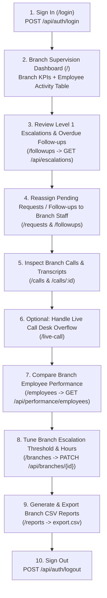

# 04 — Branch Manager Complete Work Journey

> **Accounts Audited:** `manager.rspuram@thulasipharmacy.local` (`BM-RS01`, manages RS Puram `CBE-RSP` **and** Gandhipuram `CBE-GP`) and `manager.madurai@thulasipharmacy.local` (`BM-MD01`, manages KK Nagar Madurai `MDU-KKN`)  
> **Role Code:** `branch_manager` • **Scope Level:** `branch`

---

## 1. End-to-End Daily Work Journey Diagram

---

## 2. Step-by-Step Operational Walkthrough (Login to Logout)

### Step 1: Login & Authorized Workspace
- Signs in via `POST /api/auth/login`. Backend resolves `scope_level = "branch"` and computes `allowed_branch_ids` as the union of `user.branch_id` and all branches where `branch_manager_user_id == user.id`.
- Sidebar displays **10 authorized pages**: `Overview`, `Live Call Desk`, `Calls`, `Customer Requests`, `Follow-ups`, `Employees`, `Branches`, `Reports`, `Notifications`, `Settings`. (`Zones` and `Administration` are hidden and blocked with `403`.)
- Any direct API query attempting to pass another branch's `branch_id` (e.g., RS Puram manager requesting Madurai `branch_id=3`) is rejected by the backend with `403 Forbidden`.

### Step 2: Branch Supervision Dashboard (`/`)
- Loads `GET /api/dashboard/overview?days=30`.
- **Metrics Displayed (Branch-Scoped):**
  - **Calls Today** & registered telephone calls in period
  - **Pending Requests** (`resolved` & `overdue` subcounts)
  - **Overdue Follow-ups** & upcoming scheduled callbacks
  - **Open Escalations** (`missed` & `unregistered` call indicators in sublabel)
  - **7-Day Call Activity Trend** chart (branch aggregate)
  - **Active Reminders & Alerts** (Level 1 escalation alerts targeted to the Branch Manager)
  - **Branch Employee Activity & Workload Table:** Side-by-side comparison of every active employee in the branch (`Registered Calls`, `Requests Resolved / Created`, `Pending Workload`, `Overdue Follow-ups`, `Follow-up Completion Rate %`).

### Step 3: Handling Overdue Follow-ups & Level 1 Escalations (`/followups`)
- Can click **Check Overdue & Trigger Escalations** (`POST /api/followups/evaluate-escalations`) to ensure all overdue items are surfaced.
- Inspects all branch follow-ups and the **Supervisory Escalations Queue** (`GET /api/escalations`).
- For each open Level 1 escalation:
  - Clicks **Acknowledge** (`PATCH /api/escalations/{id}`, `status='acknowledged'`) while coordinating with the assigned pharmacist.
  - Or clicks **Resolve** (`PATCH /api/escalations/{id}`, `status='resolved'`) once addressed; writes `escalation.updated` to `audit_logs`.
- Can schedule follow-ups directly assigned to any employee in their branch (`POST /api/followups`), which automatically sends an in-app `"New Follow-up Assigned"` notification to that pharmacist.

### Step 4: Supervising Requests & Balancing Workload (`/requests`)
- Views all customer medicine requests across their managed branch(es).
- Clicks **Manage** on any request to:
  - **Reassign** `assigned_employee_id` to another branch pharmacist (`requests:assign_branch`) — automatically sends a `"Request Assigned"` notification to the newly assigned employee and records `request.updated` in `audit_logs`.
  - Update workflow status, resolution details, or cancel with reason (logged in `request_status_history`).

### Step 5: Reviewing Calls, Backup Call Handling & Employee Performance
- **Calls (`/calls`, `/calls/:id`):** Reviews branch calls, filters by source type (`manual_telephone_call` vs `browser_microphone_test`), checks for `unregistered` or `missed` calls, and can update call outcomes/summaries/transcripts (`calls:update_branch`).
- **Live Call Desk (`/live-call`):** Has `live_call:use` permission to step in during peak hours.
- **Employee Performance (`/employees`):** Evaluates branch staff across `7`/`30`/`90` days using transparent formulas (`calls_registered`, `microphone_test_sessions`, `requests_resolved`, `pending_workload`, `overdue_followups`, `avg_resolution_hours`, `registration_completeness_pct`, `followup_completion_rate_pct`).

### Step 6: Branch Operational Settings (`/branches`)
- Sees only their managed branch card(s) with 30-day call/request/escalation summary.
- Clicks **Branch Settings** (`PATCH /api/branches/{id}` via `branches:manage_settings`) to adjust:
  - Branch phone number
  - Operating hours (e.g., `08:00 - 22:00`)
  - **Branch-specific Overdue Follow-up Escalation Threshold (minutes)** — overrides the global Level 1 escalation threshold specifically for this branch.
- Backend explicitly blocks (`403`) Branch Managers from modifying `zone_id`, `branch_manager_user_id`, or `is_active`.

### Step 7: Branch Reports & CSV Export (`/reports`)
- Runs all 8 report types scoped strictly to their branch(es) (`reports:branch`): Daily/Weekly/Monthly Calls, Branch Performance, Employee Performance, Pending Requests, Overdue Follow-ups, and Escalations.
- Exports authorized CSV files (`GET /api/reports/{type}/export.csv`) for upward reporting or branch huddles.

---

## 3. Upward Accountability & Escalation Behavior

- If a Level 1 escalation remains unresolved and the underlying follow-up crosses the global Level 2 threshold (default `240` minutes overdue), the escalation engine creates a **Level 2 Escalation** targeting the **Zonal Manager**, and at `1440` minutes creates a **Level 3 Escalation** targeting the **Owner**.
- All branch calls, requests, overdue follow-ups, and escalations aggregate automatically into the Zonal Manager's branch-comparison table and the Owner's executive dashboard.

---

## 4. Realistic End-to-End Operational Example (Implemented & Verified)

> **Scenario (RS Puram Branch — `manager.rspuram@thulasipharmacy.local`):**
> 1. Branch Manager logs in and sees `1` Open Escalation and `1` Overdue Follow-up on the Branch Supervision Dashboard, with an unread warning notification (`Level 1 Escalation: Callback Synthetic Customer A on Telma 40mg restock`).
> 2. Opens `/followups`, sees the escalation is 90 minutes past due (exceeding RS Puram's 60-minute threshold), and clicks **Acknowledge**.
> 3. Opens `/requests`, locates `REQ-SYNTH-0001` (`waiting_for_stock`), coordinates with the pharmacist (or reassigns it if the pharmacist is off-shift), and verifies the callback is completed.
> 4. Exports the Weekly Employee Performance CSV from `/reports` for the West Zone review meeting.

---

## 5. Gaps / Unsupported Steps in Branch Manager Journey

- **Custom Resolution Notes Prompt on Escalation Resolve:** Clicking **Resolve** in `FollowUpsPage.tsx` immediately submits a hardcoded note (`"Reviewed and resolved by manager."`) instead of prompting the manager for specific resolution details.
- **Unassigned Pharmacists in Gandhipuram (`CBE-GP`):** The bootstrapped RS Puram manager also manages `CBE-GP`, which has 0 pharmacists, so Gandhipuram shows empty operational rows until staff are assigned by System Admin.
- **Real Missed / Unregistered Telephone Call Detection:** Without a connected PBX/SIP telephony integration, `missed_calls` and `unregistered_calls` only count manually logged entries — actual unanswered desk phone rings are not automatically detected.
- **Reassigning Follow-ups in UI:** `PATCH /api/followups/{id}` supports reassigning `assigned_employee_id`, but `FollowUpsPage.tsx` only provides a **Complete** button (no Edit/Reassign Follow-up modal).
