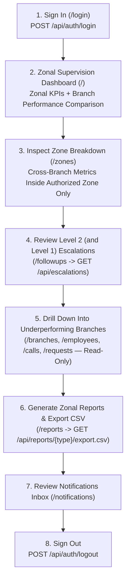

# 05 — Zonal Manager Complete Work Journey

> **Accounts Audited:** `zonal.west@thulasipharmacy.local` (`ZM-W01`, West Tamil Nadu Zone: RS Puram + Gandhipuram) and `zonal.south@thulasipharmacy.local` (`ZM-S01`, South Tamil Nadu Zone: KK Nagar Madurai)  
> **Role Code:** `zonal_manager` • **Scope Level:** `zone`

---

## 1. End-to-End Daily Work Journey Diagram

---

## 2. Step-by-Step Operational Walkthrough (Login to Logout)

### Step 1: Login & Strict Zonal Scope Binding
- Signs in via `POST /api/auth/login`. Backend resolves `scope_level = "zone"`, sets `allowed_zone_ids` from `user.zone_id` unioned with zones where `zonal_manager_user_id == user.id`, and resolves `allowed_branch_ids` to all branches inside those zones.
- Example verified via automated tests:
  - `zonal.west@thulasipharmacy.local` sees **West Tamil Nadu Zone** (`CBE-RSP`, `CBE-GP`) and receives `403 Forbidden` on any request for `MDU-KKN` or `South Tamil Nadu Zone`.
  - `zonal.south@thulasipharmacy.local` sees **South Tamil Nadu Zone** (`MDU-KKN`) and is blocked from Coimbatore branches.
- Sidebar renders **10 authorized pages**: `Overview`, `Calls`, `Customer Requests`, `Follow-ups`, `Employees`, `Branches`, `Zones`, `Reports`, `Notifications`, `Settings`. (`Live Call Desk` and `Administration` are hidden and backend-blocked.)

### Step 2: Zonal Supervision Dashboard (`/`)
- Loads `GET /api/dashboard/overview?days=30` aggregated across all branches in the zone.
- Displays:
  - Zonal KPIs (`Calls Today`, `Pending Requests`, `Overdue Follow-ups`, `Open Escalations`)
  - 7-day zonal call trend chart
  - Unread Level 2 escalation notifications
  - **Branch Performance Comparison Table:** Side-by-side branch accountability inside the zone (`Registered Calls`, `Mic Tests`, `Pending Reqs`, `Overdue Follow-ups`, `Escalations`).

### Step 3: Regional Comparison & Operational Drilldown
- **Zones (`/zones`):** Displays only the manager's authorized zone card and embedded branch-by-branch comparison table (`Registered Calls`, `Pending Reqs`, `Resolved Reqs`, `Overdue FU`, `Open Escalations`). Read-only (cannot create/edit zones).
- **Branches (`/branches`):** Displays directory cards for branches in the zone with manager names, active staff count, thresholds, and 30-day counts. Read-only (no **Branch Settings** button).
- **Employee Performance (`/employees`):** Can filter by any branch within the zone and inspect individual employee resolution speed, pending workload, overdue follow-ups, and registration quality.
- **Calls (`/calls`, `/calls/:id`) & Customer Requests (`/requests`):** Read-only drilldown into specific branch calls, text transcripts, medicine items, and request status histories (write buttons **Register Manual Call**, **New Medicine Request**, **Save Changes**, and **Save Status Update** are hidden by permissions AND blocked with `403` in the backend).

### Step 4: Handling Level 2 Escalations (`/followups`)
- When a branch follow-up exceeds the global Level 2 threshold (default `240` minutes overdue) and `POST /api/followups/evaluate-escalations` runs, a Level 2 escalation is created targeting `zone.zonal_manager_user_id` with a `critical` in-app notification.
- Zonal Manager views all follow-ups (read-only; cannot schedule or complete follow-ups on behalf of branch staff — wait: see gap below!) and manages escalations via **Acknowledge** / **Resolve** (`escalations:manage_zone`).

> **Confirmed UI/Backend Minor Mismatch Found During Inspection (`FollowUpsPage.tsx:229`):**  
> On `/followups`, the **Complete** button on each follow-up row is rendered whenever `f.status !== 'completed'`, without checking `hasPermission('followups:update_branch')`. If a Zonal Manager clicks **Complete**, the backend correctly rejects it with `403 Forbidden` and shows an error toast — the backend enforces RBAC properly, while the UI should hide the button for read-only roles. (Documented in `14_SYSTEM_GAPS_AND_RECOMMENDATIONS.md`.)

### Step 5: Zonal Reports & Upward Accountability (`/reports`)
- Runs all 8 reports across the zone (`reports:zone`), optionally filtering to a single branch inside the zone, and exports CSV reports for the Owner.
- If a Level 2 escalation remains unresolved past the Level 3 threshold (`1440` minutes overdue), the escalation engine automatically escalates it to the **Owner**.

---

## 3. Realistic End-to-End Operational Example (Implemented & Verified)

> **Scenario (West Tamil Nadu Zone — `zonal.west@thulasipharmacy.local`):**
> 1. Zonal Manager logs in and checks `/`: compares `Thulasi Pharmacy — RS Puram` (active calls, 1 pending request, 1 open escalation) against `Thulasi Pharmacy — Gandhipuram` (0 activity / 0 staff assigned).
> 2. Opens `/followups`, reviews the open escalation at RS Puram, and checks whether RS Puram's Branch Manager has acknowledged it.
> 3. Opens `/employees` filtered to RS Puram to inspect pharmacist workload and average resolution hours.
> 4. Opens `/reports`, selects **Branch Performance Report** and **Escalations Report**, and downloads CSV files for the weekly executive review with the Owner.

---

## 4. Gaps / Unsupported Steps in Zonal Manager Journey

- **No Direct In-App Messaging / Directive to Branch Managers:** Zonal Manager can acknowledge/resolve escalations, but cannot post a written directive notification back to a Branch Manager from inside the app.
- **No Zonal Escalation Trend Chart:** Dashboard shows 7-day call trends, not historical escalation-volume trend charts over weeks/months.
- **UI Complete Button Visible on Read-Only Follow-ups:** Backend blocks it (`403`), but UI does not hide the **Complete** button for Zonal Managers.
