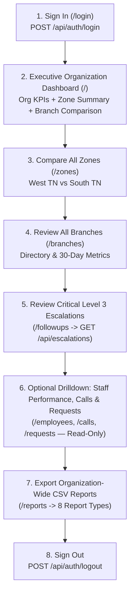

# 06 — Owner Complete Work Journey

> **Account Audited:** `owner@thulasipharmacy.local` (`Managing Director (Owner)`)  
> **Role Code:** `owner` • **Scope Level:** `org` • **Employee Profile:** None (executive user)

---

## 1. End-to-End Daily Work Journey Diagram

---

## 2. Step-by-Step Operational Walkthrough (Login to Logout)

### Step 1: Login & Organization-Wide Executive Access
- Signs in via `POST /api/auth/login`. Backend resolves `scope_level = "org"`, granting read visibility across **all zones** (`TN-WEST`, `TN-SOUTH`) and **all branches** (`CBE-RSP`, `CBE-GP`, `MDU-KKN`).
- **Strict Separation from System Administration:** By design, `owner` does **not** hold `admin:users`, `admin:roles`, `admin:branches`, `admin:zones`, `admin:settings`, `admin:integrations`, or `admin:audit_logs`. The **Administration** sidebar item is hidden and all admin endpoints return `403 Forbidden` unless a System Administrator explicitly assigns the separate `system_admin` role to the Owner account.
- Sidebar displays **10 authorized pages**: `Overview`, `Calls`, `Customer Requests`, `Follow-ups`, `Employees`, `Branches`, `Zones`, `Reports`, `Notifications`, `Settings`.

### Step 2: Executive Organization Dashboard (`/`)
- Loads `GET /api/dashboard/overview?days=30` (configurable to `7`, `30`, or `90` days).
- **Hierarchical Presentation (Aggregated First, Drilldown Available):**
  1. **Organization-Wide KPIs:** `Calls Today`, `Pending Requests` (plus resolved/overdue counts), `Overdue Follow-ups` (plus upcoming count), `Open Escalations` (plus missed & unregistered counts).
  2. **7-Day Organization Call Trend Chart:** Visualizes telephone calls vs browser mic tests vs missed calls across the entire pharmacy chain.
  3. **Active Reminders & Alerts:** Top 8 unread alerts (including Level 3 critical escalations).
  4. **Zone-Level Executive Summary Table:** Compares every zone (`Branches`, `Telephone Calls`, `Registration Rate %`, `Pending Requests`, `Overdue Follow-ups`, `Open Escalations`).
  5. **Branch Performance Comparison Table:** Compares all branches side-by-side (`Branch`, `Zone`, `Registered Calls`, `Mic Tests`, `Pending Reqs`, `Overdue Follow-ups`, `Escalations`).

### Step 3: Reviewing Critical Escalations & Drilldowns
- **Escalations (`/followups`):** Reviews open escalations across all branches and holds `escalations:manage_org` permission to **Acknowledge** or **Resolve** critical Level 3 escalations (triggered by default at `1440` minutes / 24 hours overdue).
- **Zones (`/zones`) & Branches (`/branches`):** Compares branch accountability inside each zone.
- **Employees (`/employees`):** Views organization-wide employee performance metrics and can filter by any specific branch.
- **Calls (`/calls`, `/calls/:id`) & Requests (`/requests`):** Full read-only drilldown into any branch's registered calls, transcripts, and customer medicine requests for exception audits.

### Step 4: Business Reporting & Exports (`/reports`)
- Authorized (`reports:org`) to run all 8 reports across the entire organization or filtered by specific branch and date range, and export CSV datasets (`GET /api/reports/{type}/export.csv`) for offline spreadsheet analysis or board meetings.

---

## 3. Realistic End-to-End Operational Example (Implemented & Verified)

> **Scenario (`owner@thulasipharmacy.local`):**
> 1. Owner logs in and immediately inspects the **Zone-Level Executive Summary**: sees West Tamil Nadu Zone has pending requests and open escalations while South Tamil Nadu Zone has resolved its request cleanly.
> 2. Scrolls to **Branch Performance Comparison** and notices `Thulasi Pharmacy — Gandhipuram` shows `0` registered calls and `0` requests (operational blind spot / staffing check needed with West Zonal Manager).
> 3. Opens `/reports`, switches to **Monthly Call Report** and **Pending Customer Requests Report**, and exports both as CSV for executive review.
> 4. If an urgent customer callback has been overdue > 24 hours, acknowledges/resolves the Level 3 escalation in `/followups` after speaking with the Zonal Manager.

---

## 4. Gaps / Unsupported Steps in Owner Journey

- **No Multi-Owner Escalation Broadcast:** In `backend/app/services/escalation_service.py` line 161, Level 3 escalation targets only `owners[0].id` (the first active Owner user) rather than notifying all active Owner accounts if more than one exists.
- **No Revenue / Sales Conversion Metrics:** Because ShopAid live billing/POS integration is not connected, the Owner dashboard tracks operational call/request accountability rather than sales value or prescription conversion revenue.
- **UI Complete Button Visible on Read-Only Follow-ups:** Same minor UI gap noted for Zonal Manager (`FollowUpsPage.tsx` shows **Complete**, backend properly returns `403`).
- **No Historical Month-over-Month Trend Charts Beyond 7-Day Bar Chart:** The dashboard chart is fixed to a 7-day rolling window regardless of whether the KPI selector is set to `30` or `90` days.
