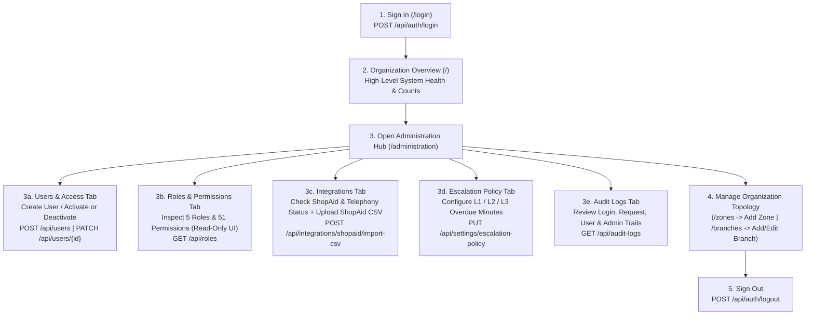

# 07 — System Administrator Complete Work Journey

> **Account Audited:** `admin@thulasipharmacy.local` (`System Administrator`)  
> **Role Code:** `system_admin` • **Scope Level:** `org` • **Employee Profile:** None

---

## 1. End-to-End Daily Work Journey Diagram

---

## 2. Step-by-Step Operational Walkthrough (Login to Logout)

### Step 1: Login & Administrative Access
- Signs in via `POST /api/auth/login`. Receives all 7 administrative permissions (`admin:users`, `admin:roles`, `admin:branches`, `admin:zones`, `admin:settings`, `admin:integrations`, `admin:audit_logs`) plus read-only organizational oversight permissions (`calls:read_org`, `requests:read_org`, `followups:read_org`, `escalations:read_org`, `performance:read_org`, `reports:org`).
- Does **not** hold operational write permissions (`live_call:use`, `calls:create`, `requests:create`, `followups:create`, `escalations:manage_org`) — maintaining clean separation of duties between IT administration and pharmacy floor/executive operations.
- Sidebar displays **11 authorized pages**: `Overview`, `Calls`, `Customer Requests`, `Follow-ups`, `Employees`, `Branches`, `Zones`, `Reports`, `Notifications`, `Administration`, `Settings`.

### Step 2: User Account Lifecycle (`/administration` → Users & Access)
- **Create User (`POST /api/users`):** Enters Full Name, Work Email, Initial Password (min 8 chars), Role (`pharmacist`, `branch_manager`, `zonal_manager`, `owner`, `system_admin`), Assigned Branch, and Assigned Zone.
  - Automatically creates an `employees` record (`EMP-XXXX`) whenever the user is assigned an operational role (`pharmacist`, `branch_manager`, `zonal_manager`), auto-derives `zone_id` from `branch_id` if omitted, hashes the password with Argon2id, and logs `admin.user_created` in `audit_logs`.
- **Activate / Deactivate User (`PATCH /api/users/{id}`):** Toggles `is_active` on both `users` and linked `employees`. Backend blocks self-deactivation (`400 Bad Request`). Deactivated users are immediately rejected on login (`403`) and on any existing JWT (`401`). Logs `admin.user_updated`.

### Step 3: Roles & Permissions Governance (`/administration` → Roles & Permissions)
- Inspects all 5 roles, hierarchy levels, and assigned permission badges (`GET /api/roles`).
- Backend also exposes `GET /api/permissions` and `PUT /api/roles/{role_id}/permissions`, though the UI tab is currently read-only (and note the baseline re-merge defect in `rbac.py` documented in `14_SYSTEM_GAPS_AND_RECOMMENDATIONS.md`).

### Step 4: Integration Adapters & ShopAid CSV Fallback (`/administration` → Integrations)
- Inspects live adapter cards for:
  - **ShopAid Inventory Software (`shopaid_inventory`):** Shows `disconnected` or `csv_fallback_only` status, read-only mode, endpoint URL (`Not configured`), and last sync timestamp.
  - **Pharmacy Telephony / SIP / PBX Adapter (`telephony_pbx`):** Shows `disconnected` status and `webhook_listener` mode.
- Clicks **Import Reference CSV** (`POST /api/integrations/shopaid/import-csv`): Uploads UTF-8 CSV (`sku,medicine_name,strength,dosage_form,manufacturer,mrp_price,stock_status`), upserting rows into `shopaid_catalog_items` tagged `csv_import_fallback`, updating `integration_configs.last_synced_at`, and writing `integration.shopaid_csv_imported` to `audit_logs`. Can search the imported catalog right in the tab.

### Step 5: Global Escalation Policy (`/administration` → Escalation Policy)
- Reads (`GET /api/settings/escalation-policy`) and saves (`PUT /api/settings/escalation-policy`) the 3 global overdue thresholds into `app_settings`:
  - Level 1 — Branch Manager (default `60` min)
  - Level 2 — Zonal Manager (default `240` min)
  - Level 3 — Owner Critical (default `1440` min)
- Writes `admin.escalation_policy_updated` to `audit_logs`.

### Step 6: Organization Configuration (`/zones` & `/branches`)
- **Zones (`/zones`):** Clicks **Add Zone** (`POST /api/zones`) to add new regional zones (`code`, `name`, `region_description`).
- **Branches (`/branches`):** Clicks **Add Branch** (`POST /api/branches`) to map new branches to zones, or **Branch Settings** (`PATCH /api/branches/{id}`) to update phone, operating hours, and branch-specific escalation threshold.

### Step 7: Security & Operational Audit Trail (`/administration` → Audit Logs)
- Views the latest 100 immutable `audit_logs` records (`GET /api/audit-logs?limit=100`) displaying Timestamp, Actor Email, Action badge (e.g., `auth.login_success`, `auth.login_failed`, `call.registered`, `request.created`, `admin.user_created`), Entity (`type#id`), and JSON details.

---

## 3. Realistic End-to-End Operational Example (Implemented & Verified)

> **Scenario (`admin@thulasipharmacy.local`):**
> 1. A new pharmacist joins the currently unstaffed Gandhipuram (`CBE-GP`) branch.
> 2. Admin signs in, opens `/administration`, clicks **Create User Account**, enters the pharmacist's details, selects role `Pharmacist / Employee`, assigns branch `Thulasi Pharmacy — Gandhipuram`, and submits.
> 3. Backend hashes password, inserts `users`, `user_roles`, and `employees` rows, and logs `admin.user_created`.
> 4. Admin switches to the **Integrations** tab, uploads the morning ShopAid CSV reference catalog export, and confirms `Dolo 650` and `Telma 40` appear in the searchable reference table.
> 5. Admin opens the **Audit Logs** tab to verify both `admin.user_created` and `integration.shopaid_csv_imported` are recorded with actor and timestamp.

---

## 4. Gaps / Unsupported Steps in System Administrator Journey

- **No Edit User Modal in UI:** Although `PATCH /api/users/{id}` supports changing a user's roles, branch, zone, designation, phone, full name, and admin password reset, `AdministrationPage.tsx` only exposes **Activate / Deactivate**.
- **No Edit Role Permissions UI (plus Backend Revocation Bug):** `PUT /api/roles/{id}/permissions` has no UI controls, and `rbac.py` re-adds baseline permissions even if removed from DB.
- **No Assign Branch Manager / Zonal Manager UI:** Neither `BranchesPage.tsx` nor `ZonesPage.tsx` exposes dropdowns to update `branch_manager_user_id` or `zonal_manager_user_id` after creation (though both `PATCH /api/branches/{id}` and `PATCH /api/zones/{id}` support it in the backend!).
- **No Integration Config Edit Form in UI:** `PATCH /api/integrations/{key}` is not wired to an edit form in `AdministrationPage.tsx`.
- **No Audit Log Search/Filter Inputs in UI:** Backend supports `?action=`, `?entity_type=`, and `?actor_email=`, but UI only fetches `?limit=100` unfiltered.
- **No Multi-Role Assignment in Create User Modal:** Create User UI uses a single `<select>` for `roleCode` (sends `[roleCode]`), so assigning dual roles like `owner` + `system_admin` requires calling the API directly.
