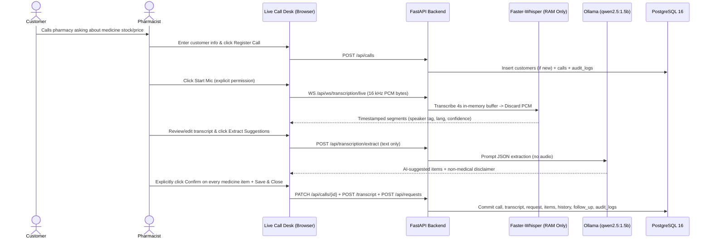
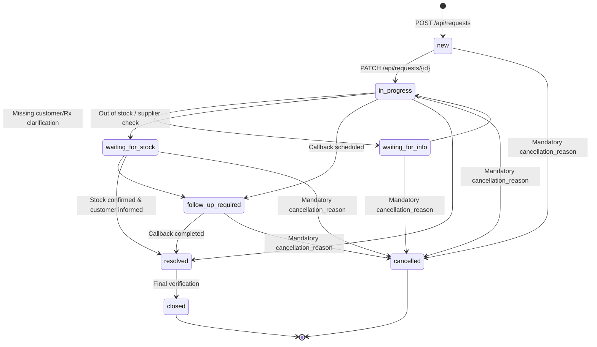
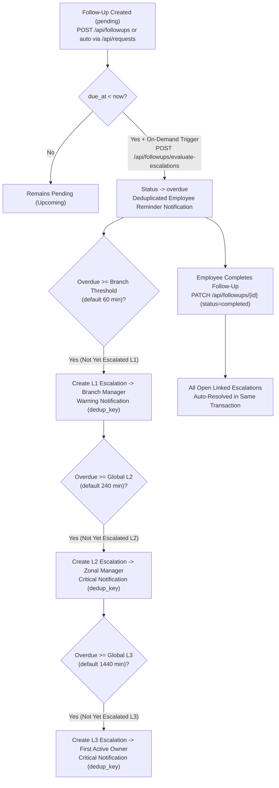

# 09 — End-to-End Business Workflows (A through S)

> Every workflow below is traced directly against the implemented code in `backend/app/` and `frontend/src/`. Steps not supported by current code are explicitly marked.

---

## Core Visual Workflow Diagrams

### 1. Customer Call-to-Resolution Sequence

### 2. Medicine Request State Machine

### 3. Follow-Up & Hierarchical Escalation Workflow

---

## Detailed Workflow Audit (A – S)

### A. Customer Phone Call Handling — **Partially implemented**
- **Starting Event:** Customer phones a branch.
- **Responsible User:** Pharmacist (or Branch Manager backup).
- **Implemented:** Manual registration via `/calls` or `/live-call`, or live speech test via browser mic.
- **Limitation:** Ordinary desk telephones cannot feed audio into the browser automatically; `verified_telephony_integration` is disconnected.

### B. Live Speech-to-Text Transcription — **Fully implemented and working (Prototype)**
- **Starting Event:** Clicking **Start Mic** on `/live-call`.
- **Steps:** Browser calls `getUserMedia` → downsamples to 16 kHz Int16 PCM → streams binary WebSocket frames to `/api/ws/transcription/live` → `TranscriptionService` runs Faster-Whisper `base` CPU INT8 + Silero VAD every ~4s → returns segments → discards PCM bytes immediately.
- **Failure Handling:** Denying mic permission or WebSocket failure displays an `ErrorBanner` and cleans up media tracks; manual transcript input remains available.

### C. Call Registration — **Fully implemented and working**
- **API:** `POST /api/calls` (`calls:create`).
- **DB Changes:** Creates `calls` row (`TC-YYYYMMDD-XXXXXX`), auto-creates/reuses `customers` row, logs `call.registered` in `audit_logs`.
- **Guardrail:** Rejects `call_source_type="verified_telephony_integration"` (`400`) unless caller has `admin:integrations`.

### D. Customer Identification — **Implemented but not fully connected**
- **Implemented:** Backend `POST /api/calls` and `POST /api/requests` deduplicate customers by `(branch_id, phone_number)` in `customers`. Dedicated `/api/customers` CRUD endpoints exist.
- **Gap:** Frontend does not expose a Customer Directory page or returning-customer phone autocomplete yet.

### E. Medicine Requirement Extraction & Confirmation — **Fully implemented and working**
- **API:** `POST /api/transcription/extract` (text-only → local Ollama `qwen2.5:1.5b`, fallback `_heuristic_extract`).
- **Safety Gate:** Every AI item starts as `ai_suggested` or `missing_info`. `LiveCallDeskPage.tsx` blocks saving until the employee explicitly clicks **Confirm** (`employee_confirmed`).

### F. Medicine Availability & ShopAid Reference Lookup — **Partially implemented**
- **API:** `GET /api/integrations/shopaid/catalog?q=...` searches `shopaid_catalog_items` (CSV snapshot fallback).
- **Gap:** Live ShopAid API is disconnected; stock status is a point-in-time CSV snapshot requiring manual verification in ShopAid.

### G. Customer Medicine Request Creation — **Fully implemented and working**
- **API:** `POST /api/requests` (`requests:create`).
- **DB Changes:** Inserts `medicine_requests` (`REQ-YYYYMMDD-XXXXXX`), 1+ `medicine_request_items`, initial `request_status_history` (`None → new`), optional `follow_ups` row when `create_followup=true`, and `audit_logs`.

### H. Request Assignment & Status Updates — **Partially implemented**
- **API:** `PATCH /api/requests/{id}`.
- **Implemented:** Full 8-status transitions, mandatory `cancellation_reason` on cancel (`400` if omitted), immutable `request_status_history`, manager reassignment (`requests:assign_branch`) triggering `request_update` notification.
- **Gap:** UI Manage modal does not allow editing individual `medicine_request_items` after creation.

### I. Customer Callback Scheduling — **Fully implemented and working**
- **API:** Auto-created via `POST /api/requests` (`create_followup=true`) or standalone via `POST /api/followups`.
- **Notifications:** Assigning a follow-up to another employee inserts a `reminder` notification (`dedup_key = fu:{id}:assigned:{user_id}`).

### J. Follow-Up Reminders — **Partially implemented**
- **Implemented:** `evaluate_overdue_followups_and_escalations()` generates deduplicated employee reminders (`fu:{id}:employee_reminder`) and sets `reminder_sent_at`.
- **Gap:** Triggered only on-demand via button / `POST /api/followups/evaluate-escalations`; no automated background scheduler or upcoming (pre-due) reminder alerts exist yet.

### K. Overdue Request Handling — **Partially implemented**
- **Implemented:** Dashboard counts `overdue_requests` where `required_followup_at < now` and status is open.
- **Gap:** Escalations trigger strictly from overdue `follow_ups` rows, NOT directly from `medicine_requests.required_followup_at` if no linked `follow_ups` row was created.

### L. Escalation to Supervisors — **Partially implemented**
- **Implemented:** Three-tier hierarchical escalation (`Level 1 → Branch Manager`, `Level 2 → Zonal Manager`, `Level 3 → Owner`), deduplicated by `(follow_up_id, escalation_level)` and notification `dedup_key`, auto-resolved when linked follow-up is completed.
- **Gaps:** Requires manual trigger (no cron); Level 3 notifies only `owners[0]` if multiple owners exist.

### M. Employee Performance Calculation — **Fully implemented and working**
- **API:** `GET /api/performance/employees?days=30&branch_id=...` computes 9 real metrics from `calls`, `call_transcripts`, `medicine_requests`, and `follow_ups`, returning explicit `METRIC_DEFINITIONS`.

### N. Branch-Level Supervision — **Fully implemented and working**
- **Scope:** `branch_manager` views branch KPIs, employee workload table, branch calls/requests/follow-ups, Level 1 escalations, branch operational settings (`PATCH /api/branches/{id}`), and branch CSV reports.

### O. Zone-Level Supervision — **Fully implemented and working**
- **Scope:** `zonal_manager` compares branches within authorized zone(s), manages Level 2 escalations, drills down read-only into branch/employee data, and exports zonal CSV reports.

### P. Owner-Level Supervision — **Fully implemented and working**
- **Scope:** `owner` views organization-wide KPIs, Zone Executive Summary, Branch Comparison, Level 3 escalations, and organization CSV reports without mixing IT admin duties.

### Q. Notifications — **Fully implemented and working**
- **Implemented:** Recipient-scoped `notifications` table, 30-second unread badge polling in `AppLayout`, `/notifications` inbox with `Unread only`, `Mark Read`, `Mark All Read`. (In-app only; no SMS/WhatsApp/email push.)

### R. User Account & Permission Management — **Partially implemented**
- **Implemented:** Create user (`POST /api/users`), Activate/Deactivate (`PATCH /api/users/{id}`), Roles inspection (`GET /api/roles`), Audit logs (`GET /api/audit-logs`).
- **Gaps:** No Edit User modal, no Edit Role Permissions UI, and baseline permissions re-merge defect in `rbac.py`.

### S. Reports & Analytics — **Fully implemented and working**
- **Implemented:** 8 real-data reports (`daily_calls`, `weekly_calls`, `monthly_calls`, `branch_performance`, `employee_performance`, `pending_requests`, `overdue_followups`, `escalations`) with date/branch filters and authorized `export.csv`.
