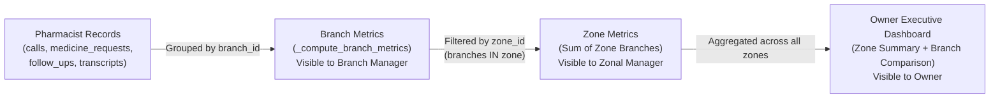

# 10 — Dashboard & Reporting Analysis

> Every formula below is traced line-by-line from `backend/app/routers/dashboard.py` and `backend/app/routers/reports.py`.

---

## 1. Dashboard Overview KPIs (`GET /api/dashboard/overview?days=30`)

**Source Tables:** `calls`, `medicine_requests`, `follow_ups`, `escalations`, `notifications`, `employees`, `branches`, `zones`.  
**Scope Filtering:**
- `self` (Pharmacist): `Call.employee_id == ctx.employee_id`, `MedicineRequest.assigned_employee_id == ctx.employee_id`, `FollowUp.assigned_employee_id == ctx.employee_id`, `escalations = []`.
- `branch` / `zone` / `org`: Filtered by `branch_id IN target_branch_ids` (intersected with optional `zone_id` / `branch_id` query parameters after RBAC validation).

| Dashboard Metric | Exact Formula in Code (`dashboard.py`) | Included / Excluded Records |
|---|---|---|
| `calls_today` | `count(calls where started_at >= today 00:00 UTC)` | **Includes ALL call source types**, including `browser_microphone_test` *(see consistency note below)* |
| `telephone_calls_period` | `count(calls in period where call_source_type in ('manual_telephone_call', 'verified_telephony_integration'))` | **Excludes** `browser_microphone_test` |
| `verified_telephony_calls` | `count(calls in period where call_source_type == 'verified_telephony_integration')` | Verified PBX/SIP calls only (currently `0`) |
| `microphone_test_sessions` | `count(calls in period where call_source_type == 'browser_microphone_test')` | Browser microphone sessions only |
| `registered_calls` | `count(telephone_calls_period where registration_status in ('registered', 'completed'))` | Excludes `draft`, `unregistered`, and all `browser_microphone_test` |
| `missed_calls` | `count(calls in period where attendance_status == 'missed')` | Includes any logged missed call |
| `unregistered_calls` | `count(calls in period where registration_status == 'unregistered' OR attendance_status == 'unregistered')` | Logged unregistered calls |
| `registration_rate_pct` | `round((registered_calls / telephone_calls_period) * 100, 1)` else `null` | `null` (displayed as `N/A`) when 0 telephone calls |
| `pending_requests` | `count(medicine_requests in period where status in ('new', 'in_progress', 'waiting_for_info', 'waiting_for_stock', 'follow_up_required'))` | Excludes `resolved`, `closed`, `cancelled` |
| `overdue_requests` | `count(pending_requests where required_followup_at IS NOT NULL AND required_followup_at < now)` | Open requests past target follow-up timestamp |
| `resolved_requests` | `count(medicine_requests in period where status in ('resolved', 'closed'))` | Excludes `cancelled` |
| `upcoming_followups` | `count(follow_ups where status == 'pending' AND due_at >= now)` | **All-time** (not clipped to `period_days`) |
| `overdue_followups` | `count(follow_ups where status in ('pending', 'overdue') AND due_at < now)` | **All-time** active overdue follow-ups |
| `open_escalations` | `count(escalations where status != 'resolved')` | **All-time** `open` + `acknowledged` escalations |
| `trend_7d` | Fixed 7-day rolling buckets (`today - 6d` .. `today`), splitting `telephone_calls`, `microphone_tests`, and `missed_calls` | Always 7 days regardless of `days` filter (`7`/`30`/`90`) |

---

## 2. Employee Performance Metrics (`GET /api/performance/employees`)

Computed in `_compute_employee_metrics()` (`backend/app/routers/dashboard.py` lines 42–136):

| Metric | Exact Formula | Source Table(s) |
|---|---|---|
| `calls_registered` | Count of employee's calls where `call_source_type in ('manual_telephone_call', 'verified_telephony_integration')` AND `registration_status in ('registered', 'completed')` | `calls` |
| `microphone_test_sessions` | Count of employee's calls where `call_source_type == 'browser_microphone_test'` | `calls` |
| `requests_created` | Count of requests where `assigned_employee_id == emp.id` within `period_days` *(Note: label says "created" in response key, but query filters by `assigned_employee_id`!)* | `medicine_requests` |
| `requests_resolved` | Subset of above where `status in ('resolved', 'closed')` | `medicine_requests` |
| `pending_workload` | Subset of above where `status in OPEN_REQUEST_STATUSES` | `medicine_requests` |
| `overdue_followups` | Count of employee's follow-ups created in period where `status in ('pending', 'overdue')` AND `due_at < now` | `follow_ups` |
| `avg_resolution_hours` | Mean of `(resolved_at - created_at) / 3600` across resolved requests with `resolved_at >= created_at` | `medicine_requests` |
| `registration_completeness_pct` | `%` of `calls_registered` that have ALL 3: `customer_phone_snapshot` AND `outcome_id IS NOT NULL` AND (`summary` OR `transcript IS NOT NULL`) | `calls`, `call_transcripts` |
| `followup_completion_rate_pct` | `completed_followups / non_cancelled_followups * 100` | `follow_ups` |

---

## 3. Upward Aggregation: Pharmacist → Branch → Zone → Owner

- **No double counting across branches:** Each `Call`, `MedicineRequest`, `FollowUp`, and `Escalation` has a single non-null `branch_id`, and each `Branch` belongs to exactly one `zone_id`.
- **Zone aggregation (`dashboard.py:350-367`):** Sums `verified_telephony_calls + manual_telephone_calls`, `registered_calls`, `pending_requests`, `overdue_followups`, and `open_escalations` strictly from the zone's `branch_comparison` rows and recalculates `registration_rate_pct = round(z_reg / z_tel * 100, 1)`.

---

## 4. All 8 Operational Reports (`GET /api/reports/{report_type}` & `/export.csv`)

| Report Type | Default Date Window | Authorized Roles | Source Tables | CSV Export |
|---|---|---|---|---|
| `daily_calls` | Last 24 hours | Branch Mgr, Zonal Mgr, Owner, Admin | `calls`, `branches`, `employees`, `call_outcomes` | ✅ Verified |
| `weekly_calls` | Last 7 days | Branch Mgr, Zonal Mgr, Owner, Admin | `calls`, `branches`, `employees`, `call_outcomes` | ✅ Verified |
| `monthly_calls` | Last 30 days | Branch Mgr, Zonal Mgr, Owner, Admin | `calls`, `branches`, `employees`, `call_outcomes` | ✅ Verified |
| `branch_performance` | Last 30 days | Branch Mgr, Zonal Mgr, Owner, Admin | `branches`, `zones`, `calls`, `medicine_requests`, `follow_ups`, `escalations` | ✅ Verified |
| `employee_performance` | Last 30 days | Branch Mgr, Zonal Mgr, Owner, Admin | `employees`, `users`, `branches`, `calls`, `call_transcripts`, `medicine_requests`, `follow_ups` | ✅ Verified |
| `pending_requests` | Last 30 days | Branch Mgr, Zonal Mgr, Owner, Admin | `medicine_requests`, `medicine_request_items`, `branches`, `employees` | ✅ Verified |
| `overdue_followups` | All currently overdue (`due_at < now`) | Branch Mgr, Zonal Mgr, Owner, Admin | `follow_ups`, `branches`, `employees` | ✅ Verified |
| `escalations` | Last 30 days | Branch Mgr, Zonal Mgr, Owner, Admin | `escalations`, `branches`, `users`, `follow_ups` | ✅ Verified |

---

## 5. Confirmed Metric Inconsistencies Found During Code Audit

1. **`calls_today` includes `browser_microphone_test`:** Unlike `telephone_calls_period` and `registered_calls` (which exclude browser mic tests), `calls_today` counts all `Call` rows from today regardless of `call_source_type`.
2. **`requests_created` vs `assigned_employee_id`:** In `_compute_employee_metrics`, the field named `requests_created` counts requests filtered by `MedicineRequest.assigned_employee_id == emp.id`, not `created_by_user_id`. If a Branch Manager reassigns a request from Pharmacist A to Pharmacist B, it moves from A's `requests_created` to B's.
3. **Dashboard Pharmacist Requests vs `/api/requests` List:** Dashboard filters Pharmacist (`self`) requests strictly by `assigned_employee_id == ctx.employee_id`, whereas `GET /api/requests` filters by `assigned_employee_id == ctx.employee_id OR created_by_user_id == ctx.user.id`.
4. **Overdue Follow-ups Window Difference:** Dashboard KPI `overdue_followups` counts **all-time** overdue follow-ups, whereas `_compute_employee_metrics` and `_compute_branch_metrics` filter `FollowUp.created_at >= date_from` (potentially omitting an older follow-up created 35 days ago that is still overdue today).
5. **`overdue_followups` Report Ignores `date_from`/`date_to`:** In `reports.py:163`, `overdue_followups` queries all currently overdue rows (`due_at < now`) regardless of the date filter selected in the UI.
