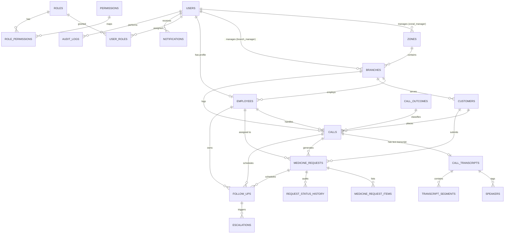

# 11 — Database Schema & API Mapping

> **Verified Against:** `backend/app/models/*.py`, live PostgreSQL 16 schema (`27` tables including `alembic_version`), OpenAPI spec (`57` REST endpoints + `1` WebSocket endpoint), and `frontend/src/`.

---

## 1. Database Entity Relationship Diagram

---

## 2. Complete PostgreSQL Table Inventory (26 Application Tables + `alembic_version`)

| # | Table Name | Live Rows (Audit Snapshot) | Purpose | Key Foreign Keys |
|---:|---|---:|---|---|
| 1 | `zones` | 2 | Regional groupings | `zonal_manager_user_id -> users.id` |
| 2 | `branches` | 3 | Pharmacy locations | `zone_id -> zones.id`, `branch_manager_user_id -> users.id` |
| 3 | `roles` | 5 | 5 RBAC role definitions | — |
| 4 | `permissions` | 51 | Granular permission codes | — |
| 5 | `role_permissions` | 81 | Role-to-permission join | `role_id`, `permission_id` |
| 6 | `users` | 8 | Staff credentials (Argon2id) & org bindings | `branch_id`, `zone_id` |
| 7 | `user_roles` | 8 | User-to-role join | `user_id`, `role_id` |
| 8 | `employees` | 6 | Operational staff profile | `user_id` (unique), `branch_id` |
| 9 | `password_reset_tokens` | 2 | SHA-256 hashed single-use reset tokens | `user_id` |
| 10 | `revoked_tokens` | 11 | Logged-out JWT `jti` denylist | — |
| 11 | `customers` | 3 | Branch-scoped customer directory | `branch_id` |
| 12 | `call_outcomes` | 8 | Standardized call outcomes | — |
| 13 | `calls` | 4 | Call register (no audio columns) | `branch_id`, `employee_id`, `customer_id`, `outcome_id` |
| 14 | `call_transcripts` | 3 | 1:1 text transcript & AI JSON | `call_id` (unique) |
| 15 | `speakers` | 3 | Unverified/verified speaker labels | `transcript_id` |
| 16 | `transcript_segments` | 3 | Timestamped text segments | `transcript_id`, `speaker_id` |
| 17 | `medicine_requests` | 4 | Customer medicine inquiry header | `branch_id`, `call_id`, `customer_id`, `assigned_employee_id`, `created_by_user_id` |
| 18 | `medicine_request_items` | 6 | Individual medicines per request | `request_id` |
| 19 | `request_status_history` | 7 | Immutable status transitions | `request_id`, `changed_by_user_id` |
| 20 | `follow_ups` | 3 | Scheduled customer callbacks | `branch_id`, `call_id`, `request_id`, `customer_id`, `assigned_employee_id` |
| 21 | `escalations` | 3 | Hierarchical overdue escalations | `branch_id`, `follow_up_id`, `request_id`, `call_id`, `target_user_id` |
| 22 | `notifications` | 6 | Recipient alerts (`dedup_key` unique) | `recipient_user_id` |
| 23 | `audit_logs` | 67 | Immutable security & action log | `actor_user_id` |
| 24 | `integration_configs` | 2 | ShopAid & Telephony adapter status | `updated_by_user_id` |
| 25 | `shopaid_catalog_items` | 2 | Read-only CSV reference catalog | — |
| 26 | `app_settings` | 0 | Global overrides (e.g., escalation mins) | `updated_by_user_id` |

---

## 3. Complete API Endpoint Inventory (`57` REST + `1` WebSocket) & UI Wiring Status

| Method | Endpoint | Required Permission(s) | Frontend Page(s) Calling It | DB Tables Touched | UI Wiring Status |
|---|---|---|---|---|---|
| `GET` | `/api/health` | Public | None (scripts/tests only) | DB ping (`SELECT 1`) | **Implemented (CLI/Test only)** |
| `POST` | `/api/auth/login` | Public | `LoginPage` | `users`, `roles`, `audit_logs` | **Connected** |
| `POST` | `/api/auth/logout` | Authenticated | `AppLayout` | `revoked_tokens`, `audit_logs` | **Connected** |
| `GET` | `/api/auth/me` | Authenticated | `AuthContext` | `users`, `roles`, `permissions`, `employees` | **Connected** |
| `POST` | `/api/auth/change-password` | Authenticated | `SettingsPage` | `users`, `audit_logs` | **Connected** |
| `POST` | `/api/auth/password-reset/request` | Public | `LoginPage` | `password_reset_tokens`, `audit_logs` | **Connected** |
| `POST` | `/api/auth/password-reset/confirm` | Public | `LoginPage` | `password_reset_tokens`, `users`, `audit_logs` | **Connected** |
| `GET` | `/api/users` | `admin:users` | `AdministrationPage` | `users`, `user_roles`, `employees` | **Connected** |
| `POST` | `/api/users` | `admin:users` | `AdministrationPage` | `users`, `user_roles`, `employees`, `audit_logs` | **Connected** |
| `PATCH` | `/api/users/{user_id}` | `admin:users` | `AdministrationPage` (is_active only) | `users`, `user_roles`, `employees`, `audit_logs` | **Partially connected** |
| `GET` | `/api/roles` | `admin:roles` \| `admin:users` | `AdministrationPage` | `roles`, `role_permissions`, `permissions` | **Connected** |
| `GET` | `/api/permissions` | `admin:roles` | **None** | `permissions` | **Not connected in UI** |
| `PUT` | `/api/roles/{role_id}/permissions` | `admin:roles` | **None** | `role_permissions`, `audit_logs` | **Not connected in UI** |
| `GET` | `/api/zones` | `zones:read` \| `admin:zones` | `ZonesPage`, `BranchesPage`, `AdministrationPage` | `zones`, `branches` | **Connected** |
| `POST` | `/api/zones` | `admin:zones` | `ZonesPage` | `zones`, `audit_logs` | **Connected** |
| `PATCH` | `/api/zones/{zone_id}` | `admin:zones` | **None** | `zones`, `audit_logs` | **Not connected in UI** |
| `GET` | `/api/branches` | Authenticated (scoped) | `BranchesPage`, `CallsPage`, `EmployeesPage`, `ReportsPage`, `AdministrationPage` | `branches`, `zones`, `employees` | **Connected** |
| `POST` | `/api/branches` | `admin:branches` | `BranchesPage` | `branches`, `audit_logs` | **Connected** |
| `PATCH` | `/api/branches/{branch_id}` | `admin:branches` \| `branches:manage_settings` | `BranchesPage` | `branches`, `audit_logs` | **Connected** |
| `GET` | `/api/employees` | Authenticated (scoped) | `RequestsPage`, `FollowUpsPage` | `employees`, `users`, `branches` | **Connected** |
| `GET` | `/api/customers` | `customers:read` | **None** | `customers`, `calls` | **Not connected in UI** |
| `POST` | `/api/customers` | `customers:write` | **None** | `customers`, `audit_logs` | **Not connected in UI** |
| `PATCH` | `/api/customers/{customer_id}` | `customers:write` | **None** | `customers`, `audit_logs` | **Not connected in UI** |
| `GET` | `/api/call-outcomes` | Authenticated | `LiveCallDeskPage`, `CallsPage`, `CallDetailPage` | `call_outcomes` | **Connected** |
| `GET` | `/api/calls` | `calls:read_*` | `CallsPage` | `calls`, `branches`, `employees`, `customers`, `call_outcomes` | **Connected** |
| `POST` | `/api/calls` | `calls:create` | `LiveCallDeskPage`, `CallsPage` | `calls`, `customers`, `audit_logs` | **Connected** |
| `GET` | `/api/calls/{call_id}` | `calls:read_*` | `CallDetailPage` | `calls`, `call_transcripts`, `transcript_segments`, `medicine_requests`, `follow_ups` | **Connected** |
| `PATCH` | `/api/calls/{call_id}` | `calls:update_*` | `LiveCallDeskPage`, `CallDetailPage` | `calls`, `audit_logs` | **Connected** |
| `POST` | `/api/calls/{call_id}/transcript` | `calls:create` \| `calls:update_*` | `LiveCallDeskPage`, `CallDetailPage` | `call_transcripts`, `speakers`, `transcript_segments`, `audit_logs` | **Connected** |
| `GET` | `/api/transcription/status` | Authenticated | `LiveCallDeskPage`, `SettingsPage` | None (live Faster-Whisper + Ollama check) | **Connected** |
| `POST` | `/api/transcription/extract` | `live_call:use` \| `calls:create` \| `requests:create` | `LiveCallDeskPage` | None (local Ollama text-only) | **Connected** |
| `WS` | `/api/ws/transcription/live` | `live_call:use` (JWT `?token=`) | `LiveCallDeskPage` | None (ephemeral RAM PCM only) | **Connected** |
| `GET` | `/api/requests` | `requests:read_*` | `RequestsPage` | `medicine_requests`, `medicine_request_items`, `request_status_history` | **Connected** |
| `POST` | `/api/requests` | `requests:create` | `LiveCallDeskPage`, `RequestsPage` | `medicine_requests`, `medicine_request_items`, `request_status_history`, `customers`, `follow_ups`, `audit_logs` | **Connected** |
| `GET` | `/api/requests/{request_id}` | `requests:read_*` | **None** (uses list item) | `medicine_requests`, `items`, `status_history` | **Not connected in UI** |
| `PATCH` | `/api/requests/{request_id}` | `requests:update_*` | `RequestsPage` | `medicine_requests`, `request_status_history`, `notifications`, `audit_logs` | **Partially connected** (no item edits in UI) |
| `GET` | `/api/followups` | `followups:read_*` | `FollowUpsPage` | `follow_ups`, `branches`, `employees`, `customers`, `calls`, `medicine_requests` | **Connected** |
| `POST` | `/api/followups` | `followups:create` | `FollowUpsPage` | `follow_ups`, `notifications`, `audit_logs` | **Connected** |
| `PATCH` | `/api/followups/{followup_id}` | `followups:update_*` | `FollowUpsPage` (complete only) | `follow_ups`, `escalations`, `audit_logs` | **Partially connected** |
| `POST` | `/api/followups/evaluate-escalations` | Authenticated | `FollowUpsPage` | `follow_ups`, `escalations`, `notifications`, `app_settings`, `audit_logs` | **Connected** |
| `GET` | `/api/escalations` | `escalations:read_*` | `FollowUpsPage` | `escalations`, `branches`, `follow_ups`, `users` | **Connected** |
| `PATCH` | `/api/escalations/{escalation_id}` | `escalations:manage_*` | `FollowUpsPage` | `escalations`, `audit_logs` | **Connected** |
| `GET` | `/api/settings/escalation-policy` | Authenticated | `AdministrationPage` | `app_settings` | **Connected** |
| `PUT` | `/api/settings/escalation-policy` | `admin:settings` | `AdministrationPage` | `app_settings`, `audit_logs` | **Connected** |
| `GET` | `/api/dashboard/overview` | `dashboard:view` | `DashboardPage` | `calls`, `medicine_requests`, `follow_ups`, `escalations`, `notifications`, `employees`, `branches`, `zones` | **Connected** |
| `GET` | `/api/performance/employees` | `performance:read_*` | `EmployeesPage` | `employees`, `calls`, `call_transcripts`, `medicine_requests`, `follow_ups` | **Connected** |
| `GET` | `/api/performance/branches` | `performance:read_branch\|zone\|org` | `BranchesPage`, `ZonesPage` | `branches`, `zones`, `calls`, `medicine_requests`, `follow_ups`, `escalations` | **Connected** |
| `GET` | `/api/notifications` | `notifications:read` | `NotificationsPage` | `notifications` | **Connected** |
| `GET` | `/api/notifications/unread-count` | `notifications:read` | `AppLayout` (30s poll) | `notifications` | **Connected** |
| `PATCH` | `/api/notifications/{id}/read` | `notifications:read` | `NotificationsPage` | `notifications` | **Connected** |
| `POST` | `/api/notifications/mark-all-read` | `notifications:read` | `NotificationsPage` | `notifications` | **Connected** |
| `GET` | `/api/reports/{report_type}` | `reports:branch\|zone\|org` | `ReportsPage` | Scoped operational tables | **Connected** |
| `GET` | `/api/reports/{report_type}/export.csv` | `reports:branch\|zone\|org` | `ReportsPage` | Scoped operational tables | **Connected** |
| `GET` | `/api/integrations` | Authenticated | `AdministrationPage` | `integration_configs` | **Connected** |
| `PATCH` | `/api/integrations/{integration_key}` | `admin:integrations` | **None** | `integration_configs`, `audit_logs` | **Not connected in UI** |
| `POST` | `/api/integrations/shopaid/import-csv` | `admin:integrations` | `AdministrationPage` | `shopaid_catalog_items`, `integration_configs`, `audit_logs` | **Connected** |
| `GET` | `/api/integrations/shopaid/catalog` | `integrations:lookup_catalog` \| `admin:integrations` | `LiveCallDeskPage`, `AdministrationPage` | `shopaid_catalog_items` | **Connected** |
| `GET` | `/api/audit-logs` | `admin:audit_logs` | `AdministrationPage` | `audit_logs` | **Connected** |
