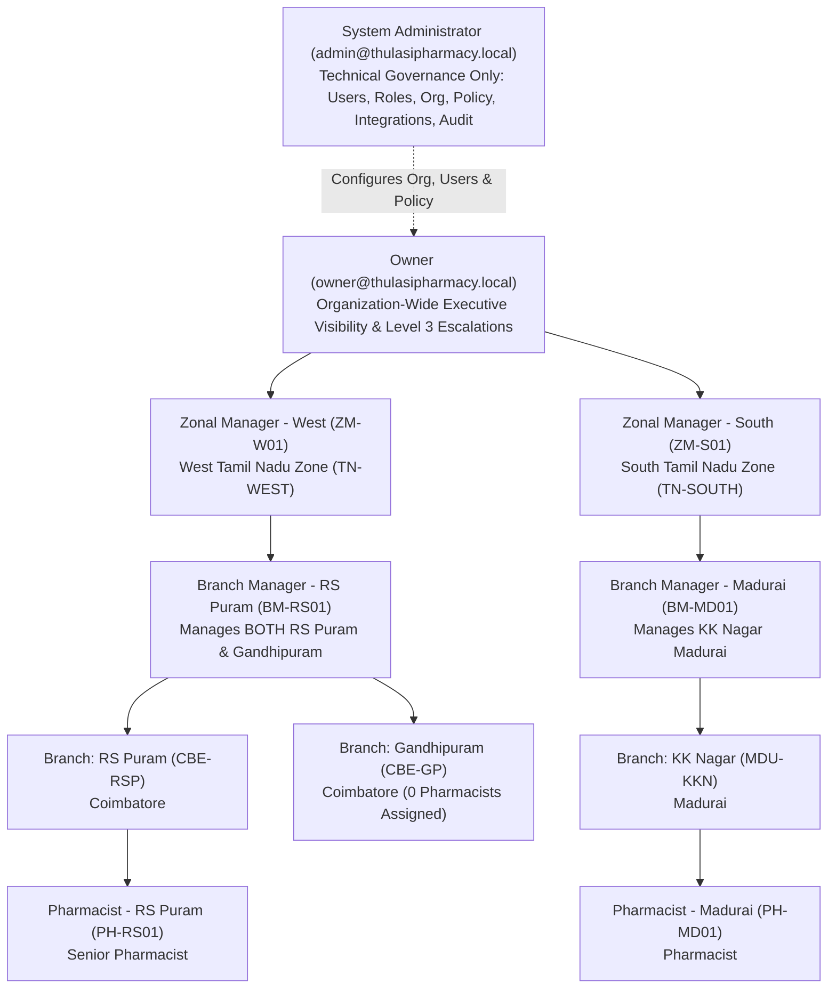
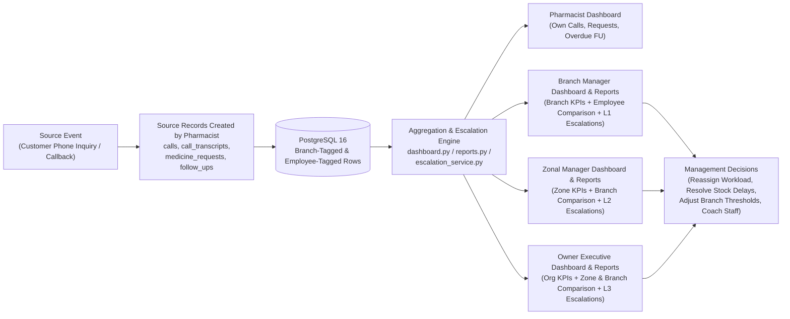

# 13 — Organizational Hierarchy & Information Data Flow

---

## 1. Actual Organizational Hierarchy Implemented in Code & Live Database

The application implements **two parallel structures** rather than a single linear chain:
1. **Business Supervision Hierarchy:** `Owner → Zonal Manager → Branch Manager → Pharmacist`
2. **Independent Technical Governance Role:** `System Administrator` (governs users, roles, org topology, policies, integrations, and audit logs across the organization, but does **not** participate in operational call handling or escalation resolution).

---

## 2. Complete Reporting & Information Flow (Pharmacist → Owner)

---

## 3. Who Generates vs. Who Consumes Information

| Information Stream | Primary Generator(s) | Storage Table(s) | Consumed By | Management Decision Enabled |
|---|---|---|---|---|
| Call Intake & Transcripts | Pharmacist, Branch Manager | `calls`, `call_transcripts`, `transcript_segments` | Pharmacist (own), Branch Mgr (branch), Zonal Mgr (zone), Owner & Admin (org) | Audit registration quality, spot missed/unregistered calls, verify inquiry text |
| Multi-Item Medicine Requests | Pharmacist, Branch Manager | `medicine_requests`, `medicine_request_items`, `request_status_history` | All management tiers (scoped) | Track out-of-stock patterns, rebalance pending workload, measure avg resolution time |
| Scheduled Callbacks & Overdue Status | Pharmacist, Branch Manager | `follow_ups` | Pharmacist (own), Branch/Zonal/Owner (scoped) | Prevent forgotten callbacks; enforce SLA completion rates |
| Escalation Alerts (L1 / L2 / L3) | Escalation Engine (triggered on demand) | `escalations`, `notifications` | L1 → Branch Mgr; L2 → Zonal Mgr; L3 → Owner | Rapid supervisory intervention on stalled customer inquiries |
| Employee & Branch Performance Reports | Computed dynamically from DB | Read-only aggregation (`dashboard.py`, `reports.py`) | Branch Mgr (branch), Zonal Mgr (zone), Owner & Admin (org) | Compare branch/staff responsiveness and export CSV summaries |
| Security & Change Audit Trail | All write endpoints + Auth | `audit_logs` | System Administrator only (`admin:audit_logs`) | Forensic accountability for logins, user changes, request updates, and settings |

---

## 4. Direct API Enforcement Verification

Direct HTTP requests bypassing the frontend UI were verified in `tests/test_backend_api.py` and inspected across all 12 routers:
- **Pharmacist:** Direct `GET /api/users`, `GET /api/audit-logs`, `GET /api/reports/daily_calls`, or `GET /api/calls?employee_id=<other>` → **`403 Forbidden`**.
- **Branch Manager (RS Puram):** Direct `GET /api/calls?branch_id=3` or `GET /api/requests?branch_id=3` (Madurai) → **`403 Forbidden`**.
- **Zonal Manager (West):** Direct `GET /api/calls?branch_id=3` (Madurai) → **`403 Forbidden`**.
- **Owner:** Direct `GET /api/users` → **`403 Forbidden`** (unless separately granted `system_admin`).
- **All Roles:** Revoked JWT after `/api/auth/logout` or deactivated `User.is_active = False` → **`401 Unauthorized`**.
